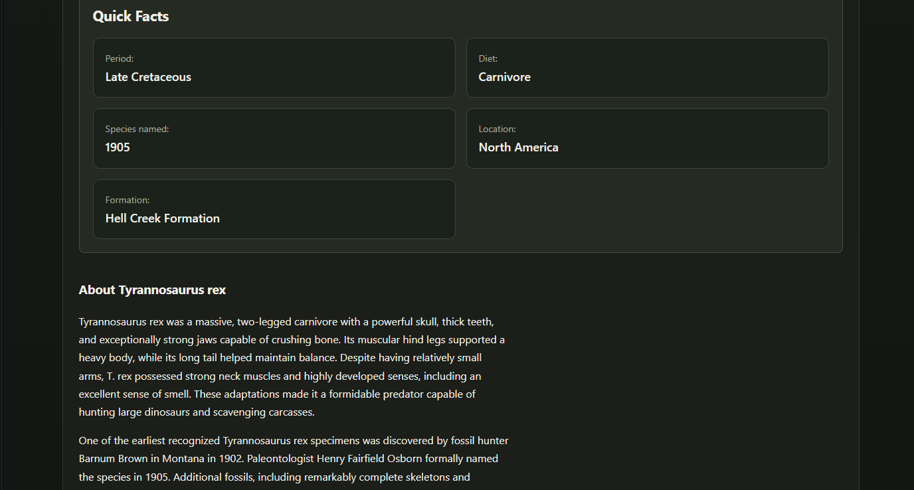

# 🦖 PaleoArchive

PaleoArchive is a dinosaur archive I built using HTML, CSS, and JavaScript.

I originally started this project to get more practice with JavaScript. As I worked on it, I decided to expand it into something closer to a digital natural history museum, where users could explore different dinosaurs and learn more about them.

The website currently features 12 dinosaurs, each with its own information, illustrations, and interactive 3D skeleton.

**Live Website:** https://paleoarchive.vercel.app

---

## Project Status

PaleoArchive v1.0 is complete and available online.

The current version includes 12 dinosaur exhibits, along with search, filtering, sorting, illustrations, and interactive skeletons.

I may return to the project in the future to add more prehistoric species or improve existing features.

---

## Features

- 12 dinosaur exhibits
- Search dinosaurs by name, diet, location, and geological period
- Filter dinosaurs by geological period
- Sort dinosaurs alphabetically
- Interactive 3D skeletons with rotation and zoom
- Switch between illustrations and skeletons
- Scientific illustrations with anatomical information
- Quick facts and dinosaur descriptions
- Responsive layout for desktop and mobile
- Scroll animations for dinosaur cards
- Keyboard-friendly controls
- Links to the original 3D models
- Coming Soon section for future additions

---

## Design

I wanted PaleoArchive to feel like a digital natural history museum, so I went with a dark green color scheme, prehistoric environments, and dinosaur silhouette cards.

I used AI-generated artwork for the dinosaur cards and exhibit illustrations, then worked on how everything would be presented throughout the website.

During development, I made adjustments to the layout, spacing, card sizes, backgrounds, and exhibit pages to make the interface feel more consistent.

I also worked on making the website responsive so it could be used on both desktop and mobile screens.

---

## Screenshots

Here are some screenshots of the finished website.

### Homepage

The main page, including the introduction and search controls.

### Dinosaur Collection

The collection of 12 dinosaurs.

### Interactive 3D Skeleton

The Tyrannosaurus rex skeleton displayed using Google Model Viewer.

### Dinosaur Illustration

An illustrated Tyrannosaurus rex exhibit with anatomical information.

### Dinosaur Information

Each exhibit also includes quick facts and information about the dinosaur.

### Coming Soon Section

The bottom of the homepage, including the Coming Soon section and footer.

---

## Tech Stack

- HTML
- CSS
- JavaScript
- Vite
- Google Model Viewer
- glTF Transform
- Git and GitHub
- Vercel

---

## How It Works

### Dynamic Dinosaur Data

Instead of creating a separate HTML page for each dinosaur, I stored their information in JavaScript objects.

The website uses this data to generate the dinosaur cards and individual exhibit pages.

This also makes it easier to add more dinosaurs without having to create entirely new pages.

### Search, Filtering, and Sorting

I used JavaScript to make the dinosaur collection searchable and filterable.

Users can search for specific dinosaurs, filter them by geological period, and sort them alphabetically.

These features work together, and the result count updates depending on the dinosaurs being displayed.

### Interactive Skeletons

Each dinosaur has an interactive 3D skeleton that users can rotate and zoom.

I used Google's Model Viewer library to display the models and added buttons that let users switch between the illustration and skeleton views.

### Performance Optimization

One challenge I ran into was the size of some of the 3D skeleton files.

Several models were extremely large, with some exceeding 100 MB.

I used glTF Transform to optimize these models, including geometry compression and texture optimization, which significantly reduced their file sizes.

I also changed the JavaScript so the Model Viewer library is loaded when a visitor chooses to view a skeleton, rather than immediately when the website opens.

This reduced the initial JavaScript bundle from approximately 1 MB to 26 KB, while loading the larger viewer code separately when needed.

### Responsive Design

I used CSS Grid, Flexbox, and media queries to make the website work across different screen sizes.

I also worked on keyboard navigation, interactive button states, and reduced-motion support.

---

## Running Locally

To run PaleoArchive locally, clone the repository:

`git clone https://github.com/madeinmemory/paleoarchive.git`

Navigate to the project folder:

`cd paleoarchive`

Install the dependencies:

`npm install`

Start the development server:

`npm run dev`

To create a production build:

`npm run build`

---

## 3D Model Credits

The dinosaur skeleton models used in PaleoArchive were obtained from Sketchfab.

I want to give credit to the creators and institutions who made these models available.

Some models were compressed or optimized to reduce their file sizes and improve performance in the browser.

| Dinosaur          | Creator / Source              | Original Model                                                                                                             |
| ----------------- | ----------------------------- | -------------------------------------------------------------------------------------------------------------------------- |
| Tyrannosaurus rex | marcllobet                    | [Sketchfab](https://sketchfab.com/3d-models/tyrannosaurus-rex-skeleton-9aabc82e228141b2b8bba56849032430)                   |
| Stegosaurus       | Olof Moleman                  | [Sketchfab](https://sketchfab.com/3d-models/stegosaurus-skeleton-bca2e8f0a4e84cdda146bbd286f0e84a)                         |
| Coelophysis       | Matthew Schroyer              | [Sketchfab](https://sketchfab.com/3d-models/coelophysis-c8fee7a21dbc465d8fae98a0df4d190e)                                  |
| Plateosaurus      | Natural History Museum Vienna | [Sketchfab](https://sketchfab.com/3d-models/plateosaurus-skeleton-80683eb568cc46caac0649e395fa5a1b)                        |
| Allosaurus        | Olof Moleman                  | [Sketchfab](https://sketchfab.com/3d-models/allosaurus-skeleton-2193dcd84b694f659719b4b99c91228b)                          |
| Diplodocus        | Natural History Museum Vienna | [Sketchfab](https://sketchfab.com/3d-models/diplodocus-carnegii-nhmw-geo-190900040003-1d07ae9e002f4e8ab930dc92d07eb078)    |
| Triceratops       | toaste                        | [Sketchfab](https://sketchfab.com/3d-models/triceratops-skeleton-4f4e38e8c70a42f391ed2353a7b4c091)                         |
| Spinosaurus       | PlaugesOfDeath                | [Sketchfab](https://sketchfab.com/3d-models/spinosaurus-skeleton-3eb1da77354e4f65a29734a9a9b40a35)                         |
| Protoceratops     | Natural History Museum Vienna | [Sketchfab](https://sketchfab.com/3d-models/protoceratops-andrewsi-nhmw-geo-201504040001-ed6e419065af422eaaa07294f55b8be1) |
| Psittacosaurus    | Natural History Museum Vienna | [Sketchfab](https://sketchfab.com/3d-models/psittacosaurus-mongoliensisnhmw-geo199800641-f25dc41ec23242a588772f2205410722) |
| Carnotaurus       | Magorius                      | [Sketchfab](https://sketchfab.com/3d-models/carnotaurus-sastrei-skeleton-04c8d6e0e1794091aeae0d2f54cca43b)                 |
| Parasaurolophus   | Olof Moleman                  | [Sketchfab](https://sketchfab.com/3d-models/baby-parasaurolophus-skeleton-18de87dd270f478bbbeb310cd514cc00)                |

The models remain the work of their respective creators and are subject to their individual licenses. Original sources are linked above.

---

## Author

Built by Alex.

**Live Website:** https://paleoarchive.vercel.app

**GitHub Repository:** https://github.com/madeinmemory/paleoarchive
