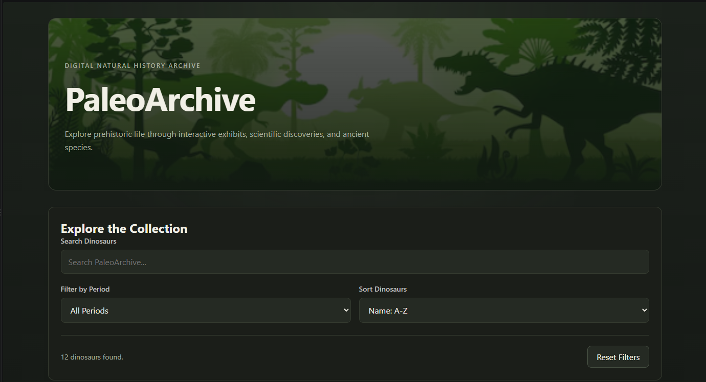
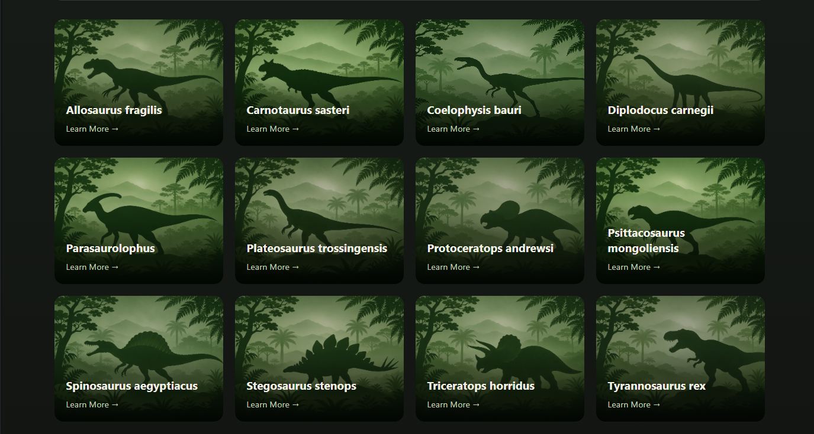
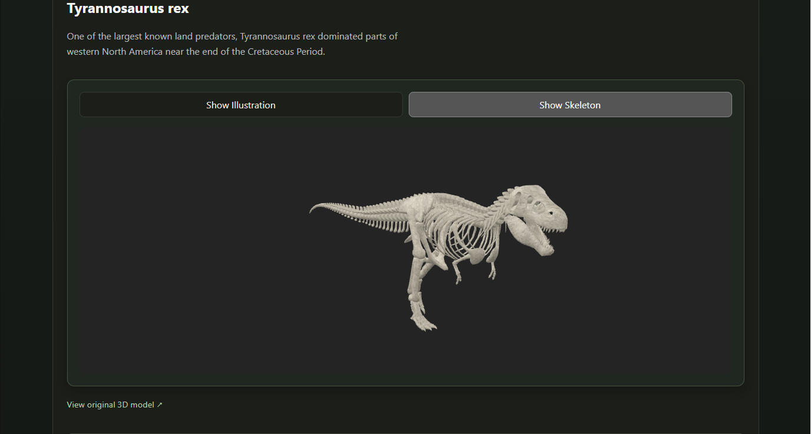
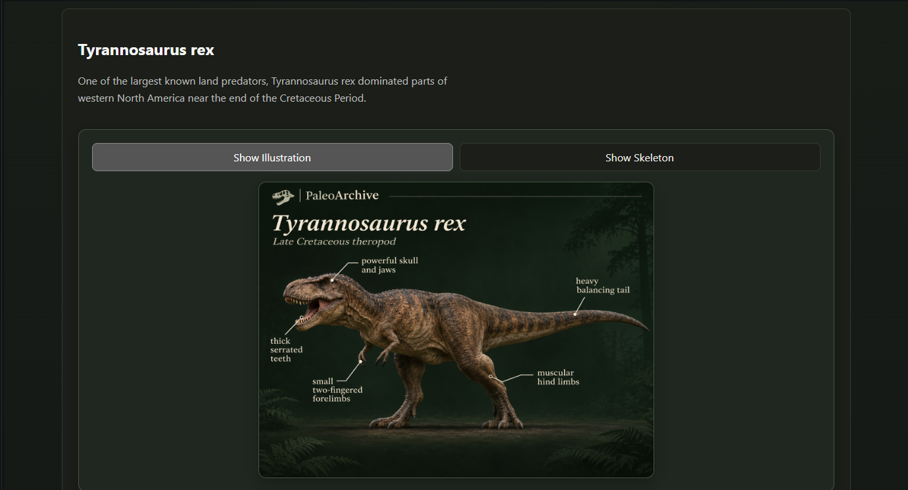
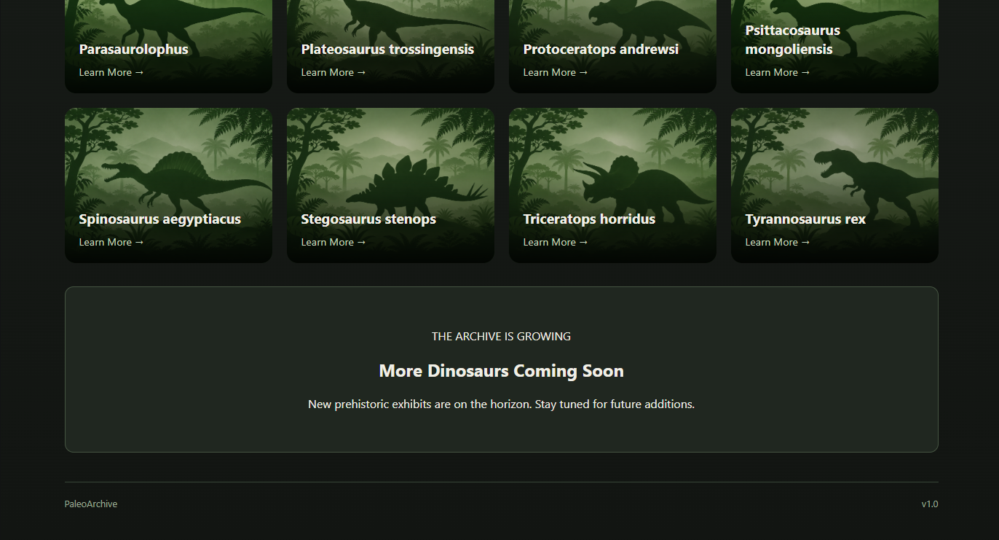

# 🦖 PaleoArchive

**PaleoArchive** is an interactive digital natural history archive built with vanilla JavaScript, HTML, and CSS.

Explore prehistoric life through a collection of 12 dinosaur exhibits featuring scientific information, custom illustrations, and interactive 3D skeletal models.

🌐 **[Visit the Live Website](https://paleoarchive.vercel.app)**

---

## 📸 Preview

### Homepage



### Dinosaur Collection



### Interactive 3D Skeleton



### Scientific Illustration



### Dinosaur Information


### Coming Soon & Footer



---

## ✨ Features

- **12 Dinosaur Exhibits** — Explore prehistoric species through detailed information and artwork.
- **Interactive 3D Skeletons** — Rotate and zoom skeletal reconstructions.
- **Dynamic Search** — Search dinosaurs by name, diet, location, or geological period.
- **Period Filtering** — Filter the collection by geological period.
- **Alphabetical Sorting** — Organize dinosaurs by name.
- **Scientific Illustrations** — View illustrated reconstructions with anatomical callouts.
- **Responsive Design** — Layouts adapt to desktop and mobile screens.
- **Scroll Animations** — Animated cards using the Intersection Observer API.
- **Accessible Controls** — Keyboard-friendly controls, visible focus states, and reduced-motion support.
- **Model Source Links** — Direct links to the original 3D models.
- **Coming Soon Section** — A preview of future archive additions.

---

## 🛠️ Built With

- **HTML5** — Page structure and semantic elements
- **CSS3** — Styling, responsive layouts, and animations
- **JavaScript (ES6+)** — Dynamic rendering, event handling, search, and filtering
- **Vite** — Development server and production build tooling
- **Google Model Viewer** — Interactive 3D model rendering
- **glTF Transform** — 3D asset optimization
- **Git & GitHub** — Version control
- **Vercel** — Website hosting and deployment

---

## ⚡ Technical Highlights

### Dynamic Rendering

Dinosaur cards and detail pages are generated dynamically from a structured JavaScript data collection.

This allows new exhibits to be added without manually creating separate HTML pages.

### Search, Filtering, and Sorting

JavaScript dynamically updates the displayed dinosaur collection based on user input.

Search, geological period filtering, and alphabetical sorting work together.

### Lazy Loading

3D skeleton models are loaded only when visitors select the **Show Skeleton** option.

This avoids downloading large 3D assets unnecessarily.

### Dynamic Imports and Code Splitting

The Google Model Viewer library is loaded on demand using JavaScript's dynamic `import()` functionality.

This reduced the initial JavaScript bundle from approximately **1,050 KB to 26 KB**, a reduction of about **97.5%**.

### 3D Asset Optimization

Large skeletal models were optimized using glTF Transform, including Draco geometry compression and WebP texture compression.

Several models were reduced by more than 90% in download size while maintaining their visual appearance.

### Accessibility and Responsive Design

The application supports keyboard navigation, accessible toggle-button states, reduced-motion preferences, and mobile-responsive layouts.

---

## 💻 Running Locally

**1. Clone the repository**

```bash
git clone https://github.com/madeinmemory/paleoarchive.git
```

**2. Navigate into the project**

```bash
cd paleoarchive
```

**3. Install dependencies**

```bash
npm install
```

**4. Start the development server**

```bash
npm run dev
```

**5. Build for production**

```bash
npm run build
```

---

## 🦴 3D Model Credits

PaleoArchive uses third-party dinosaur skeleton models obtained from Sketchfab.

Special thanks to the artists, creators, and institutions who made these models available.

| Dinosaur          | Creator / Source              | Original Model                                                                                                             |
| ----------------- | ----------------------------- | -------------------------------------------------------------------------------------------------------------------------- |
| Tyrannosaurus rex | marcllobet                    | [Sketchfab](https://sketchfab.com/3d-models/tyrannosaurus-rex-skeleton-9aabc82e228141b2b8bba56849032430)                   |
| Stegosaurus       | Olof Moleman                  | [Sketchfab](https://sketchfab.com/3d-models/stegosaurus-skeleton-bca2e8f0a4e84cdda146bbd286f0e84a)                         |
| Coelophysis       | Matthew Schroyer              | [Sketchfab](https://sketchfab.com/3d-models/coelophysis-c8fee7a21dbc465d8fae98a0df4d190e)                                  |
| Plateosaurus      | Natural History Museum Vienna | [Sketchfab](https://sketchfab.com/3d-models/plateosaurus-skeleton-80683eb568cc46caac0649e395fa5a1b)                        |
| Allosaurus        | Olof Moleman                  | [Sketchfab](https://sketchfab.com/3d-models/allosaurus-skeleton-2193dcd84b694f659719b4b99c91228b)                          |
| Diplodocus        | Natural History Museum Vienna | [Sketchfab](https://sketchfab.com/3d-models/diplodocus-carnegii-nhmw-geo-190900040003-1d07ae9e002f4e8ab930dc92d07eb078)    |
| Triceratops       | toaste                        | [Sketchfab](https://sketchfab.com/3d-models/triceratops-skeleton-4f4e38e8c70a42f391ed2353a7b4c091)                         |
| Spinosaurus       | PlaugesOfDeath                | [Sketchfab](https://sketchfab.com/3d-models/spinosaurus-skeleton-3eb1da77354e4f65a29734a9a9b40a35)                         |
| Protoceratops     | Natural History Museum Vienna | [Sketchfab](https://sketchfab.com/3d-models/protoceratops-andrewsi-nhmw-geo-201504040001-ed6e419065af422eaaa07294f55b8be1) |
| Psittacosaurus    | Natural History Museum Vienna | [Sketchfab](https://sketchfab.com/3d-models/psittacosaurus-mongoliensisnhmw-geo199800641-f25dc41ec23242a588772f2205410722) |
| Carnotaurus       | Magorius                      | [Sketchfab](https://sketchfab.com/3d-models/carnotaurus-sastrei-skeleton-04c8d6e0e1794091aeae0d2f54cca43b)                 |
| Parasaurolophus   | Olof Moleman                  | [Sketchfab](https://sketchfab.com/3d-models/baby-parasaurolophus-skeleton-18de87dd270f478bbbeb310cd514cc00)                |

Some downloaded models were modified through geometry and texture optimization for browser use. Original creators retain their respective rights.

See the original Sketchfab listings for licensing information.

Dinosaur illustrations and silhouette artwork were created with the assistance of AI image-generation tools and curated for visual consistency.

---

## 📌 Project Status

**Version:** 1.0

PaleoArchive's initial collection of 12 dinosaurs is complete and deployed.

Future updates may introduce additional prehistoric species, exhibits, and improvements.

---

## 👨‍💻 Development

PaleoArchive is an independent front-end development portfolio project built to practice and demonstrate JavaScript, responsive web design, DOM manipulation, performance optimization, and interactive user interfaces.

**[Explore PaleoArchive](https://paleoarchive.vercel.app)**
